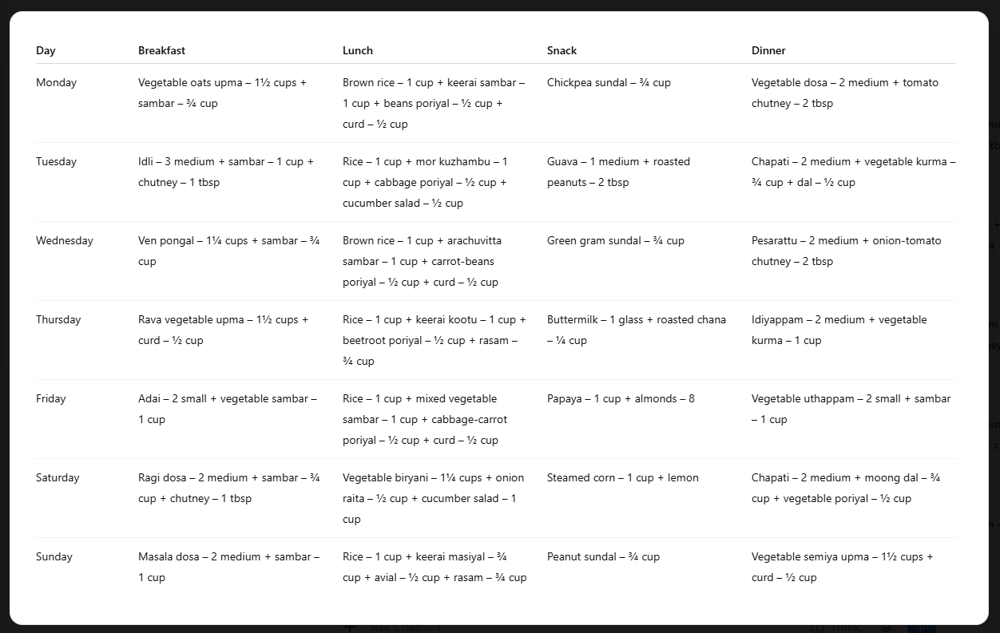
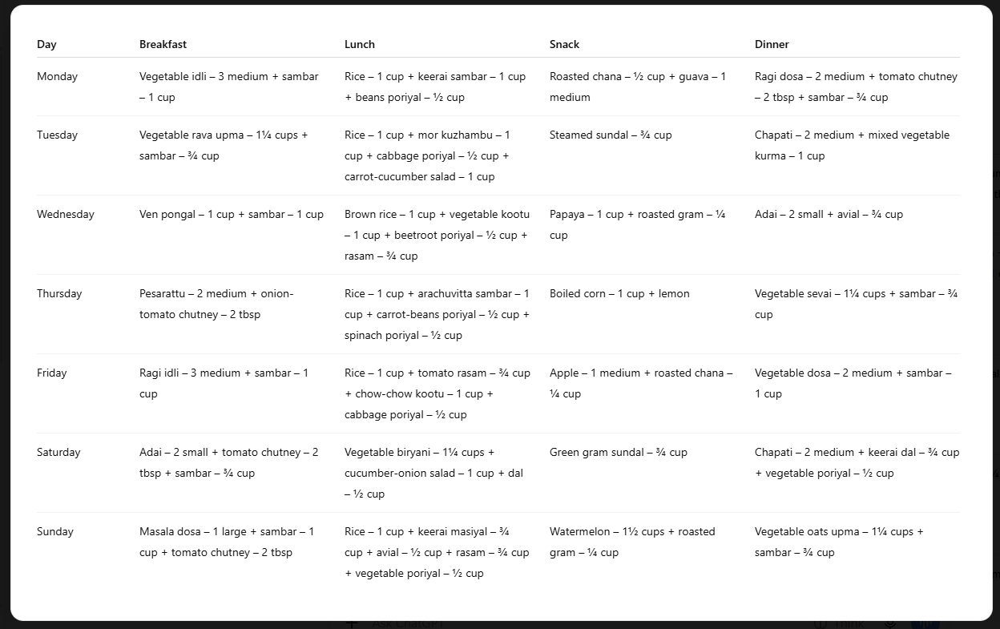

# RTCFR Prompt Engineering

A practical exploration of structured prompt design using the RTCFR framework:

**Role → Task → Context → Few Shots → Response**

The focus is on creating prompts that are clear, reusable, and consistent across different inputs.

**Use Case:** The prompt is designed to generate a healthy 7-day vegetarian South Indian meal plan for a person working towards weight loss, while allowing the same prompt to adapt to different user requirements.

## Prompt Design

The prompt is structured around five areas:

- **Role** — Defines the type of assistant generating the meal plan.
- **Task** — Defines exactly what needs to be produced.
- **FOR** — Contains the editable user-specific inputs: age, activity level, allergies and dislikes.
- **Constraints** — Controls food choices, practicality, portions and other requirements.
- **Response Format** — Forces a consistent 7-day table with one row per day.

The editable `FOR` block is intentionally kept separate from the rest of the prompt. This makes it possible to reuse the same prompt for different people by changing only their personal requirements.

## Reusability Test

The same prompt was tested with two different `FOR` configurations.

### Run 1

The `FOR` section used:

```text
Age: 38
Activity level: Lightly Active
Allergies: None
Dislikes: None
```


### Run 2

The `FOR` section used:

```text
Age: 45
Activity level: Sedentary
Allergies: Nuts
Dislikes: Curd and buttermilk
```



The same core prompt was used for both runs. Only the user-specific information in the `FOR` section was changed, demonstrating that the prompt can be reused for different users without rewriting the core instructions.

## Prompt Engineering Principles

This implementation demonstrates:

- Structured prompt design using RTCFR
- Clear role and task definition
- Separation of fixed instructions and editable context
- Explicit constraints
- Controlled response formatting
- Reusable prompt design
- Testing with different inputs

## Repository Structure

```text
rtcfr-prompt-engineering/
├── meal_plan_prompt.md
├── README.md
└── screenshots/
    ├── run-1.png
    └── run-2.png
```

The meal-planning scenario is used as a practical example to demonstrate the prompt-engineering technique. The focus of this repository is the reusable prompt structure and its behaviour across different inputs.

## Notes

The prompt is designed for structured meal-plan generation and is not intended to replace professional dietary advice.